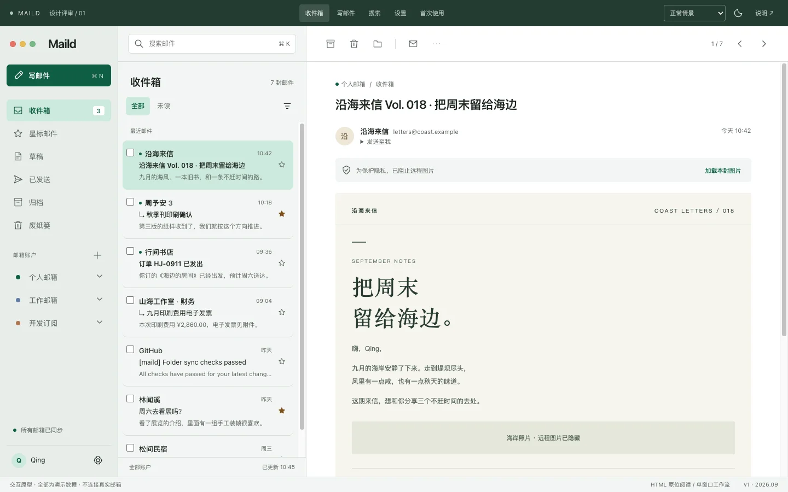

# 设计原型验证记录

日期：2026-09-11。对象：`prototype/index.html`、`style.css`、`app.js`。

结论：**用户已认可主界面总体方向；v1.1 新增的界面扩展与窗口设计待评审。** 浏览器原型不代表 Tauri 已实现，也不替代 WKWebView、真实邮箱、VoiceOver 与签名发布测试。

后续状态（2026-09-23）：用户已授权按原型推进，03-A/E01、04、08-A/B/C 仓库实现已完成。
本记录保留当时的原型证据；当前实现与原生视觉补验见 [实现计划](IMPLEMENTATION-PLAN.md) 和 [测试清单](../../testing/README.md)。

## v1.1 界面扩展与窗口（2026-09-11）

新增 `UI-EXTENSIONS.md` 与可信的 `prototype/extensions.js` 演示脚本；离线单文件生成器同步包含扩展脚本。

已在隔离浏览器页面检查：

- 未启用示例时无插件侧栏或工具栏入口；启用后出现“摘录”和“摘录集”。
- 授权前没有摘要；本封授权后显示；切换邮件保留原上下文，显式切换到另一封时重新确认范围。
- 页面内摘录可从独立工作页找回；侧栏和工作页使用同一份演示状态。
- 用户点击分离按钮后创建真正的浏览器窗口；主面板只留占位，没有第二个编辑器。
- 隐藏占位后重新打开仍指向原窗口，原绑定不随主界面选中项偷偷改变。
- 独立窗口编辑后，先通过消息交接最新文本，再收回并关闭旧窗口；文本保留。
- 停用仍有独立窗口的示例时，窗口关闭、入口移除；重新启用保留演示摘录，读取授权重新确认。
- 1440/1024/768/375px 均无文档水平溢出；1440 并排显示，较窄宽度在阅读区单层切换。
- 单文件 `file:` 原型也验证分离、编辑、收回；外部 CSS/JS 引用为 0。
- HTTP 与离线原型对应最终检查未出现 JavaScript 控制台错误。

验证中修正了离线窗口来源匹配：`location.origin` 返回 `file://`，`postMessage` 实测来源为 `null`。仅在本地文件模式使用对应来源值，仍同时核验真实子窗口/opener 引用；HTTP 模式继续匹配明确 origin。该逻辑只服务可信原型，不构成第三方沙箱设计。

截图：[阅读侧栏](screenshots/07-extension-panel.webp)、[独立扩展窗口](screenshots/08-extension-window.webp)。浏览器窗口演示不替代 Tauri 单实例、最后窗口退出、资源预算、权限撤销或恶意插件测试；这些已列入 E01–E03 计划。

## 预览入口修复（2026-09-11）

用户反馈 localhost 链接打不开。复现为：4176 端口仍监听，HTTP 请求却返回空响应；原工具会话已不存在，残留 Python 进程的 stdout/stderr 仍是管道。标准库 `send_response` 在写响应头之前先向 stderr 记录请求，失效日志管道会中断响应。

仅停止已核对身份的旧预览进程，改用 Orca 的 `Maild UI preview` 终端托管。再次请求返回 HTTP 200；在 Orca 内置浏览器打开并点击“写邮件”，确认编辑表单出现。服务当前只监听本机回环地址。

另生成 [独立离线版](Maild-UI-Preview.html)：已在 `file:` 浏览器页面验证文件夹视图与写信切换，外部 stylesheet/script 引用均为 0。它不依赖 HTTP 服务；源原型修改后用 `build-preview.py` 重新生成。

## 已执行的检查

| 检查 | 结果 | 范围 |
|---|---|---|
| `node --check docs/design/tauri/prototype/app.js` | 通过 | JavaScript 语法 |
| 1440 / 1024 / 768 / 375px × 5 个主页面 | 无文档级水平溢出 | 收件箱、写信、搜索、设置、首次使用 |
| 375px 阅读 | 正文可见、返回列表存在 | 主界面不被 HTML 撑宽 |
| 7 组设置页面 | 均可打开，标题对应 | 账户、外观、隐私、通知、地址、扩展、后台 |
| 13 个评审情景 | 均渲染，1440px 无文档水平溢出 | 正常、离线、后台断开、unknown、认证、索引、空、无结果、加载、HTML 错误、版本、发信失败、发信未知 |
| 页面网络 | 仅本地设计资源 | 无远程字体、图片、API 或邮箱连接 |
| 浏览器控制台 | 最终原型导航与页面检查无 JavaScript 错误 | 首次 HTTP 预览出现 favicon 404，已改内联图标 |
| Markdown 本地文件链接 | 检查设计文件及修改的索引/路线/进度/ADR | 不把外部链接可达性与本地链接存在性混算 |

375px 设置分类采用**有意的横向滚动条**，末尾 tab 在容器可视范围外，不属于整个窗口溢出。此宽度仅用于评审材料可访问性，本阶段没有手机产品交付承诺。

## 交互检查（22 项）

通过浏览器 DOM 输入、点击、提交与结果断言检查：

1. 会话历史展开。
2. 同一封回复收起后仍保留文本。
3. 切换邮件不串用上一封回复草稿。
4. 空收件人出现就地错误。
5. 展开抄送不清空已输入正文。
6. 抄送内非法地址被校验。
7. 返回收件箱后通过草稿继续编辑。
8. 发送中字段冻结。
9. 模拟发送成功进入已发送视图。
10. 中文“发票”搜索命中样本。
11. 有附件筛选保留对应结果。
12. 批量选择数量准确。
13. 批量归档移出源列表。
14. 同步队列展示对应两封邮件。
15. unknown 提供查看目标、重试、不再重试三个入口。
16. unknown 重试前说明副本风险。
17. 后台未连接时归档禁用。
18. 明确投递失败保留正文和错误说明。
19. 投递未知时禁止再次发送。
20. 账户向导探测阶段分别展示收发状态。
21. 演示秘密值不进入后续页面文字。
22. 首次使用完成后进入邮件工作区。

另检查了个人账户“管理”显示个人账户地址，不复用工作账户身份。上述为原型状态演示，不声称通过真实服务测试。

## 已查看截图

| 画面 | 截图 |
|---|---|
| 1440×900 浅色收件箱 / HTML | [01-inbox-light.webp](screenshots/01-inbox-light.webp) |
| 同窗口写邮件 | [02-compose.webp](screenshots/02-compose.webp) |
| 账户设置 | [03-settings.webp](screenshots/03-settings.webp) |
| 深色外壳 + 邮件原色 | [04-inbox-dark.webp](screenshots/04-inbox-dark.webp) |
| 375×900 窄屏阅读 | [05-narrow-reader.webp](screenshots/05-narrow-reader.webp) |
| 首次使用 | [06-onboarding.webp](screenshots/06-onboarding.webp) |

## 本轮发现并修正

- 导航按钮继承居中对齐，造成各行图标错位；统一左对齐。
- 列表缺少 flex/grid 最小高度约束，长列表挤过页脚；固定在独立滚动区。
- 暗色 token 变化但 body 继承了 root 上计算出的浅色文字；让 body 显式消费文字/底色 token。
- 回复文字可能在切换邮件后串用；按邮件与回复模式隔离页面内草稿。
- 模拟发送期间只禁按钮，未禁输入；现在发送/未知状态冻结编辑字段。
- 管理账户弹层误用固定工作账户信息；根据实际点击的演示账户显示。

## 原型近似与保留门禁

这些有明确说明，不能被当作已完成实现：

- 草稿只有本次页面内存；刷新/关页会清除，没有真实持久化。
- 邮件发送、IMAP 探测、归档、恢复、规则与账户修改均为本地演示，没有 RPC。
- 新附件/附件保存、可信名单、包安装、备份恢复是“入口 + 目标说明”，未伪装成真实上传、下载或安装。
- 收件人是文本框，尚未实现完整 chip 自动补全；搜索演示只覆盖关键词、账户、今天/全部时间与附件，其他结构化条件有规范但没有完整原型表单。
- HTML iframe 使用固定高度样本，尚未模拟任意长信的高度协商、任意链接和所有 MIME 类型。
- 平台交通灯是装饰；窗口激活、系统菜单、Dock、通知、资源释放、分栏拖拽都需 Tauri 真机验收。
- 快捷键有代表性演示，不宣称浏览器能接管系统保留快捷键；完整 VoiceOver、键盘焦点恢复与实际合成颜色对比度待生产实现核验。
- 真实前端身份授权、独立修复窗口与缓存截断问题仍是实施前提，不因原型按钮可点击就消失。

## 用户评审建议

优先确认四件事：列表密度与正文比例、墨绿/灰白方向、内联回复与整页写信切换、七组设置是否好找。然后用顶部情景控件检查出错时是否知道发生了什么、下一步能做什么。

记录反馈时可直接说“读信区再宽一点”“列表过松”“写信更想保留列表”或指出具体页面。只在用户明确满意后进入生产前端实现。
